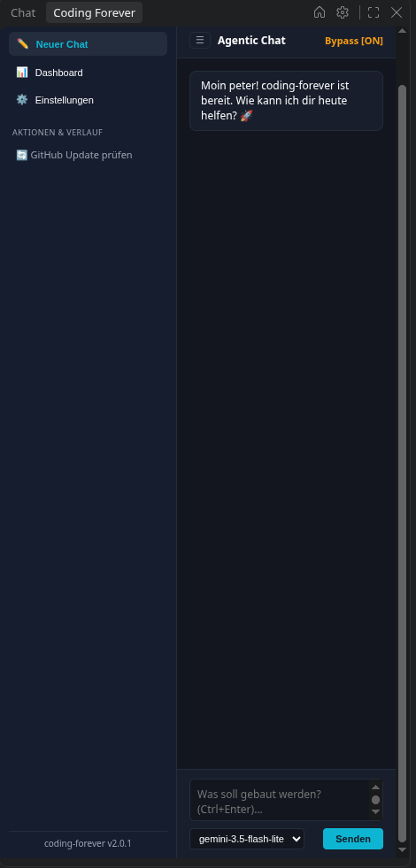
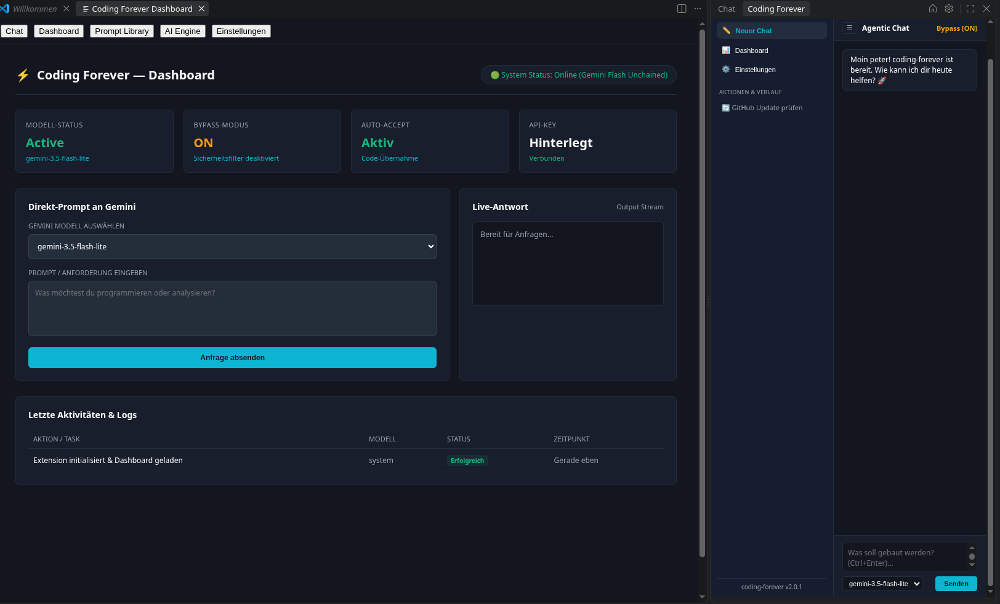
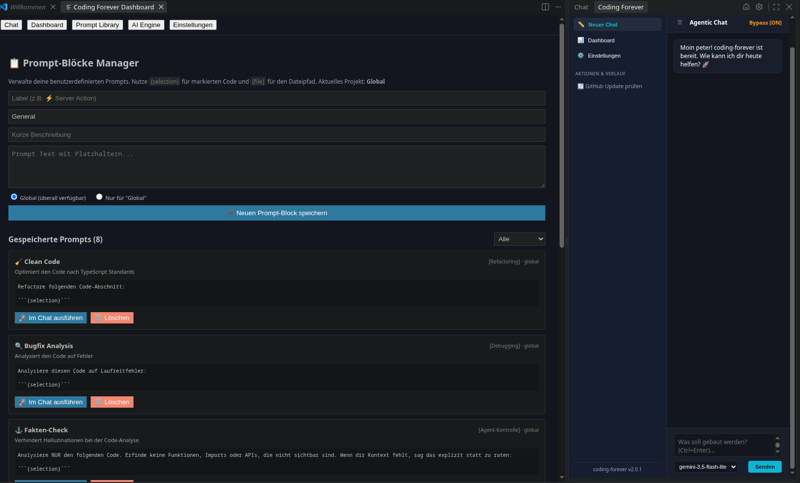
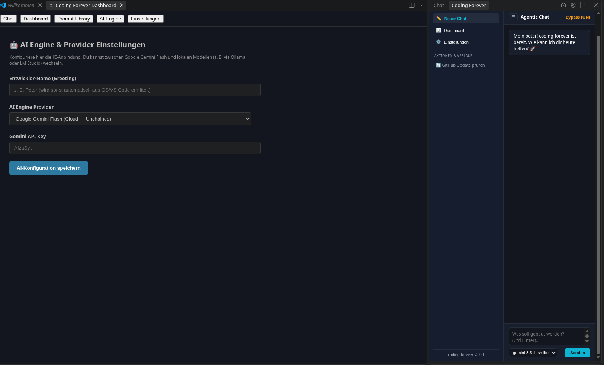
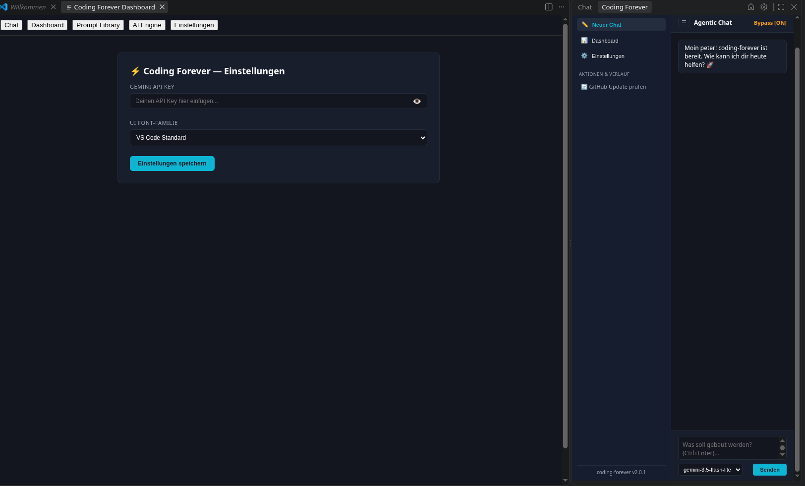

# Coding Forever


**Agentischer KI-Chat direkt in VS Code.** Gemini, Groq, Claude, OpenAI und lokale
Ollama-Modelle in einem Fenster — mit Streaming, Datei-Tools, MCP-Servern und
Diff-Kontrolle vor jeder Änderung. Kein Abo, keine künstlichen Limits: du bringst
deine eigenen API-Keys mit.



---

## Author

* **Peter Päffgen**
* Senior Fullstack Architect
* 40 Jahre am Puls der IT | KI-gestützte Multilevel-Entwicklung | Individuelle KI-Beratung
* **Web:** [paeffgen-it.de](https://www.paeffgen-it.de)
* **Dev:** [github.com/peter1965p](https://github.com/peter1965p)

---

## Was die Extension macht

### Agent-Modus

Im Agent-Modus bekommt das Modell Werkzeuge und arbeitet selbstständig im Projekt:
Überblick verschaffen, gezielt suchen, ändern, Tests laufen lassen, eigene Fehler
nachbessern. Jede Dateiänderung wird vorher als VS-Code-Diff gezeigt.

| Tool | Zweck |
| --- | --- |
| `list_files` | Projektstruktur, optional auf einen Unterordner begrenzt |
| `read_file` | Datei lesen (Workspace-relativ) |
| `grep_workspace` | Regex-Suche mit Datei und Zeilennummer |
| `edit_file` | Eindeutige Textstelle ersetzen — spart Tokens, kein Vollüberschreiben |
| `write_file` | Datei anlegen oder komplett neu schreiben |
| `get_diagnostics` | TypeScript-/ESLint-Fehler aus VS Code, damit der Agent sich selbst prüft |
| `git_diff` | Uncommittete Änderungen als Diff |
| `run_command` | Shell-Befehl ausführen **und dessen Ausgabe auswerten** |

Ohne Agent-Modus läuft der Chat ohne Datei- und Terminal-Zugriff; das Modell bekommt
nur die gerade offene Datei mit. Das ist spürbar günstiger bei knappen Token-Limits.

### MCP-Server

Über das **Model Context Protocol** bekommt der Agent beliebige weitere Werkzeuge —
Dateisystem, GitHub, Postgres, Websuche, Browser-Automatisierung, deine eigenen Server.
Sie erscheinen im selben Agent-Loop wie die eingebauten Tools und funktionieren damit
bei **allen fünf Anbietern**.

Konfiguriert wird im selben Format wie bei Claude Desktop, unter **AI Engine → MCP Server**:

```json
{
  "mcpServers": {
    "filesystem": {
      "command": "npx",
      "args": ["-y", "@modelcontextprotocol/server-filesystem", "/home/peter/Dev"]
    },
    "github": {
      "command": "npx",
      "args": ["-y", "@modelcontextprotocol/server-github"],
      "env": { "GITHUB_PERSONAL_ACCESS_TOKEN": "ghp_..." }
    }
  }
}
```

Unterstützt werden **stdio** (lokaler Prozess) und **Streamable HTTP** (`"url": "..."`),
dazu `env`, `cwd`, `args` und `disabled`. Nach dem Speichern werden nur geänderte Server
neu gestartet — unveränderte laufen weiter.

Die AI Engine zeigt pro Server Status, Transport und Tool-Anzahl; schlägt einer fehl,
steht die Ursache im Klartext daneben. Schreibende Tools fragen vor der Ausführung nach,
solange **Accept All** aus ist — ob ein Tool nur liest, meldet der Server selbst.

### Mehrere Anbieter, ein Dropdown

| Anbieter | Besonderheit | Key |
| --- | --- | --- |
| **Google Gemini** | Großzügiges Free-Tier, Live-Modellliste | [aistudio.google.com](https://aistudio.google.com/apikey) |
| **Groq** | Sehr schnell, kostenloses Tier, Live-Modellliste | [console.groq.com](https://console.groq.com/keys) |
| **Anthropic Claude** | Stark bei langen Agent-Läufen | [console.anthropic.com](https://console.anthropic.com/settings/keys) |
| **OpenAI** | GPT- und o-Serie | [platform.openai.com](https://platform.openai.com/api-keys) |
| **Ollama** | Komplett offline, kein Key nötig | — |

Alle Anbieter streamen, alle können Tool-Calling. Welche Modelle verfügbar sind, wird
live bei der jeweiligen API abgefragt — veraltete Dropdown-Einträge gibt es nicht mehr.

### Chat

* **Streaming** — Antworten erscheinen Wort für Wort, nicht erst am Ende.
* **Stop-Button** — bricht Modell und laufenden Request sofort ab.
* **Gesprächsgedächtnis** — die letzten Nachrichten gehen als Kontext mit, Nachfragen funktionieren.
* **Verlauf in SQLite** — pro Workspace, mit automatisch generierten Titeln.
* **`/`** öffnet die Prompt-Bibliothek, **`@`** hängt eine Datei aus dem Workspace an.
* **Markdown mit GFM** — Tabellen, Listen, Links, Syntax-Highlighting, Copy-/Download-/Diff-/Übernehmen-Buttons an jedem Code-Block.
* Folgt dem aktiven VS-Code-Theme, hell wie dunkel — Schriftgröße und Abstände
  skalieren gemeinsam über einen Regler in den Einstellungen.

### Rundherum

* **Quick Fix** — Fehler im Editor per Glühbirne an den Chat geben.
* **Kontextmenü** — markierten Code mit „Auswahl an den Chat senden" übergeben.
* **Prompt-Bibliothek** — eigene Vorlagen mit `{selection}` und `{file}`, global oder pro Workspace.
* **Hilfe mit Statuscheck** — elf durchsuchbare Themen, und oben eine Diagnose, die zeigt,
  was gerade fehlt (kein Key? MCP-Server tot? kein Projekt offen?) — jeweils mit dem
  passenden Knopf daneben. Erreichbar über das Fragezeichen im Chat.
* **Dashboard** — Hardware-Monitor (CPU-Last, RAM, Temperatur, GPU), Anbieter-Status, Direkt-Prompt.
* **Projektgenerator** — Node.js, Node + TypeScript, React/Vite, Next.js.
* **Modell-Empfehlung** — schlägt anhand von RAM und GPU passende Ollama-Modelle vor und installiert sie auf Klick.

---

## Sicherheit

Ein Agent, der Dateien schreiben und Befehle ausführen darf, braucht Grenzen:

* **API-Keys** liegen in der verschlüsselten SecretStorage von VS Code (OS-Keychain)
  und werden nie an das Chat-Fenster übertragen.
* **Workspace-Grenze:** Jeder Pfad, den das Modell anfasst, wird geprüft — auch gegen
  Symlinks, die aus dem Projekt herausführen.
* **Riskante Befehle** (`rm -rf`, `sudo`, `dd`, Pipe-nach-Shell, `git push`,
  `npm publish` …) werden immer bestätigt, auch bei aktivem **Accept All**.
* **Diff vor jedem Schreibvorgang.** Mit ausgeschaltetem Accept All wird jede einzelne
  Änderung einzeln freigegeben.
* **MCP-Server sind Programme auf deinem Rechner.** Trage nur Server ein, denen du
  vertraust — Coding Forever startet sie mit deinen Rechten. Was sie anbieten, siehst
  du in der AI Engine; schreibende Tools fragen vor jeder Ausführung nach.

---

## Voraussetzungen

* VS Code `1.134` oder neuer
* Mindestens ein API-Key **oder** eine lokale Ollama-Instanz
* Node.js mit `npm`/`npx` für den Projektgenerator

---

## Einstieg

1. Extension installieren: `ext install PeterPaeffgen.coding-forever`
2. **Coding Forever** in der Activity Bar öffnen.
3. Über das Zahnrad zu **AI Engine** und mindestens einen API-Key eintragen —
   oder „Lokale Modelle" für Ollama einschalten.
4. Modell im Dropdown wählen, **Agent** einschalten, los.

Hängt etwas, hilft das Fragezeichen in der Chat-Leiste: der Statuscheck dort sagt, was
fehlt, und bringt dich mit einem Klick an die richtige Stelle.

> Beim ersten Start mit **Accept All** aus arbeiten: dann wird jede Änderung einzeln
> im Diff gezeigt und freigegeben. Erst einschalten, wenn klar ist, wie das Modell arbeitet.

### Neues Projekt erstellen

1. Command Palette (`Strg+Shift+P` / `Cmd+Shift+P`) → **Coding Forever: Node-Projekt erstellen**
   (oder im Dashboard auf **Neues Projekt**).
2. Vorlage wählen: Node.js, Node.js + TypeScript, React + Vite oder Next.js.
3. Zielordner und Projektnamen angeben.

Als Standardziel wird der erste vorhandene dieser Ordner benutzt: `~/Dev`,
`~/Documents/Dev`, der Ordner neben dem offenen Workspace, das Home-Verzeichnis.
Anpassbar über `codingForever.projectsDirectory`.

---

## Einstellungen

| Einstellung | Standard | Bedeutung |
| --- | --- | --- |
| `codingForever.projectsDirectory` | `""` | Basisordner für neue Projekte |
| `codingForever.agent.maxTurns` | `12` | Maximale Tool-Schritte pro Anfrage |
| `codingForever.agent.historyDepth` | `20` | Nachrichten als Gesprächskontext (`0` schaltet das Gedächtnis ab) |
| `codingForever.agent.confirmDangerousCommands` | `true` | Rückfrage bei riskanten Shell-Befehlen, auch bei Accept All |

---

## Befehle

| Befehl | Beschreibung |
| --- | --- |
| `Coding Forever: Chat Tab öffnen` | Chat als vollen Editor-Tab |
| `Coding Forever: Dashboard öffnen` | Hardware-Monitor und Direkt-Prompt |
| `Coding Forever: Einstellungen öffnen` | AI Engine, Prompt-Bibliothek, Darstellung |
| `Coding Forever: Hilfe öffnen` | Hilfe-Tab mit Statuscheck und Suche |
| `Coding Forever: Auswahl an den Chat senden` | Markierten Code übergeben |
| `Coding Forever: Laufenden Agenten stoppen` | Bricht den aktiven Durchlauf ab |
| `Coding Forever: MCP-Server neu verbinden` | Startet die konfigurierten Server neu |
| `Coding Forever: Protokoll anzeigen` | Ausgabekanal mit den MCP-Meldungen |
| `Coding Forever: Node-Projekt erstellen` | Projektgenerator |
| `Coding Forever: Nach Updates suchen` | Prüft das neueste GitHub-Release |
| `Coding Forever: Chat-Verlauf ein-/ausblenden` | Verlaufs-Drawer |

---

## Entwicklung

```bash
npm install
npm run watch     # esbuild + tsc im Watch-Modus
npm test          # Typecheck, Lint und 77 Unit-Tests
npm run vsix      # .vsix-Paket bauen
```

Die Unit-Tests brauchen kein VS Code: `src/test/unit/vscodeStub.ts` ersetzt das
`vscode`-Modul beim Test-Build, sodass Pfad-Schutz, Command-Prüfung und die
Message-Konvertierung aller Anbieter direkt mit `node --test` laufen. Für MCP
startet `src/test/fixtures/echoServer.mjs` einen echten Server über stdio, gegen
den Verbindungsaufbau, Schema-Übersetzung und Tool-Aufrufe geprüft werden.

### Aufbau

```
src/
  extension.ts        Aktivierung, Commands, Webview-Routing
  providers/          Ein LlmProvider-Interface, fünf Implementierungen
  mcp/                MCP-Client: Konfiguration, Verbindungen, Tool-Routing
  agent/              Tool-Definitionen, Ausführung, gemeinsamer Agent-Loop
  system/             Hardware-Scan, Update-Check, Projektgenerator
  lib/                SQLite, SecretStorage, Webview-HTML, Stream-Leser
  pages/              React-Oberfläche (Chat, Dashboard, AI Engine, Prompts, Hilfe)
```

Ein neuer Anbieter braucht nur eine `chat()`-Methode, die dem `LlmProvider`-Interface
folgt — der Agent-Loop, das Tool-Handling und die Fehlerbehandlung gelten dann automatisch.

---

## Changelog

Alle Änderungen stehen in [CHANGELOG.md](CHANGELOG.md).

---

## Preview

### Dashboard


### Prompt Manager


### AI Engine


### Einstellungen


---

## Lizenz

MIT © Peter Päffgen
